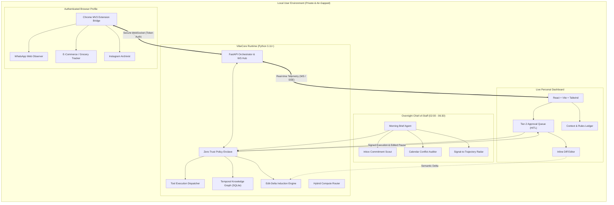

# VibeCore (Context-Intuition) 🧠⚡

> **Open-Source, Local-First, Privacy-Preserving Personal Agent Swarm Runtime**  
> Built by **[Sandeep Hipparagi](https://github.com/Sandeep-Hipparagi)**

[](LICENSE)
[](https://www.python.org/downloads/)
[](https://nodejs.org/)
[](#architecture)
[](#zero-trust-policy-enclave)

---

## 🌟 Overview: What is Context Intuition?

Standard conversational AI agents are **stateless and reactive**: you type a prompt, it queries a flat vector database, executes tools, and terminates.

**VibeCore** implements **Context Intuition**—a longitudinal, local-first agent runtime designed to run on your machine 24/7. It observes your daily workflows, models evolving preferences through semantic edit-deltas, anticipates unvoiced commitments, operates browser sessions via your own authenticated browser profile, and enforces strict cryptographic human-in-the-loop (HITL) approval gates before executing high-stakes actions.



---

## 🏛️ Core Architectural Pillars

### 1. The Longitudinal Context Intuition Engine (Beyond Flat RAG)
- **Temporal Knowledge Graph:** Structured state ledger (`ContextNode` & `ContextEdge`) holding evolving preferences, goals, and factual knowledge.
- **Sleep Consolidation:** Runs a nightly compression pass (02:00–06:30) to compute temporal decay curves, prune stale interaction noise, and consolidate raw daily episodes into strategic trajectory nodes.
- **Edit-Delta Learning:** When you edit a staged draft (email, WhatsApp reply, or scheduling proposal) in the approval queue, the engine computes a semantic diff (`original_draft` vs. `user_final`) and induces reusable `BehavioralRule` directives without bloating context windows.

### 2. Zero-Trust Policy Enclave & Deterministic Guardrails
Every tool execution is deterministically classified into one of three security tiers:

| Tier | Category | Autonomy | Description & Typical Operations |
| :--- | :--- | :--- | :--- |
| **`TIER_0_OBSERVE`** | Sensing | Full Autonomy | Read-only sensing: parsing inboxes, calendar audit, scraping prices, monitoring arXiv/GitHub. |
| **`TIER_1_STAGE`** | Staging | Full Autonomy | Fully reversible drafts: drafting emails, injecting WhatsApp compose text, cutting video clips, staging shopping carts. |
| **`TIER_2_COMMIT`** | Execution | **Hard Pause (HITL)** | Irreversible mutations: transmitting messages, deleting files, checkouts, modifying calendars, cloud compute creation. |

All `TIER_2` operations suspend execution and serialize their payload, diff preview, and calculated risk score into the **Approval Queue**. Execution resumes only upon explicit user signoff.

### 3. Authenticated Browser Session Bridge (Manifest V3)
Instead of brittle headless browser scraping with stored plaintext credentials, VibeCore pairs a Manifest V3 Chrome Extension with a local WebSocket bridge. The extension runs inside your personal, authenticated Chrome profile—cleanly leveraging existing cookies, sessions, and multi-factor authentication states.

---

## 🚀 One-Command Developer Quickstart

### Prerequisites
- **Python 3.11+**
- **Node.js 20+** and **npm**
- Local inference server (e.g., [Ollama](https://ollama.ai) running `llama3.2` or `mistral`)

---

### Step 1: Clone Repository
```bash
git clone https://github.com/Sandeep-Hipparagi/Context-Intuition.git
cd Context-Intuition
```

---

### Step 2: One-Command Setup

#### On Linux / macOS:
```bash
chmod +x scripts/dev.sh
./scripts/dev.sh setup
```

#### On Windows (PowerShell):
```powershell
.\scripts\dev.ps1 setup
```

*(Or via GNU Make: `make setup`)*

---

### Step 3: Launch Local Swarm Runtime & Dashboard

#### On Linux / macOS:
```bash
./scripts/dev.sh dev
```

#### On Windows (PowerShell):
```powershell
.\scripts\dev.ps1 dev
```

*(Or via GNU Make: `make dev`)*

This prints your active bridge token and opens:
- **Live Dashboard UI:** [http://127.0.0.1:5173](http://127.0.0.1:5173)
- **FastAPI Orchestrator & Docs:** [http://127.0.0.1:8000/docs](http://127.0.0.1:8000/docs)
- **Dashboard WebSocket Stream:** `ws://127.0.0.1:8000/ws/dashboard`
- **Chrome Bridge WebSocket:** `ws://127.0.0.1:8000/ws/browser-bridge`

---

### Step 4: Load Chrome Extension (Manifest V3)
1. Build the extension bundle:
   ```bash
   # Linux/macOS:
   ./scripts/dev.sh build-ext
   # Windows PowerShell:
   .\scripts\dev.ps1 build-ext
   ```
2. Open Google Chrome and navigate to `chrome://extensions/`.
3. Enable **Developer mode** (top right toggle).
4. Click **Load unpacked** and select the [`chrome-extension/dist/`](chrome-extension/dist/) folder.
5. Click the VibeCore icon in your browser toolbar, paste your local token from `~/.vibecore/bridge.token`, and verify the status badge turns **Connected**.

---

## 🧪 Testing & Verification

Run the full Python test suite and verify UI/Extension compilation with a single command:

```bash
# Linux/macOS:
./scripts/dev.sh test

# Windows PowerShell:
.\scripts\dev.ps1 test

# GNU Make:
make test
```

---

## 🔒 Security & Local Handshake Tokens

VibeCore binds strictly to `127.0.0.1`. Upon first launch, the orchestrator generates an ephemeral handshake token at `~/.vibecore/bridge.token` (or via `VIBECORE_BRIDGE_TOKEN`). Both the Chrome Extension and Dashboard validate this token during WebSocket connection negotiation to prevent cross-origin localhost interception.

Scraped DOM elements transmitted by the Chrome Extension are automatically isolated inside `<untrusted_dom_payload>` security delimiters to prevent indirect prompt injection from malicious external web pages.

---

## 🗺️ Roadmap & Milestones

For a breakdown of completed milestones and upcoming community features, see [ROADMAP.md](ROADMAP.md).

---

## 🚀 Wave 4 Highlights (v0.3.0)

### 🔍 Hybrid Semantic + Temporal Search
- **LocalEmbeddingEngine**: Ollama `nomic-embed-text` embeddings with deterministic offline fallback (feature-hashed unit vectors).
- **Persistent Vector Store**: `node_embeddings` SQLite table with binary blobs, auto-generated on node upsert.
- **Hybrid Ranking**: `hybrid_score = 0.6 × cosine_similarity + 0.4 × normalized_temporal_relevance`.
- **Live Search UI**: Real-time search bar in Dashboard `ContextInspector` with score badges and clickable results.

### 🧩 Declarative Browser Workflow Plugin Registry
- **WorkflowPlugin Contract**: `id`, `hostPatterns`, `canarySelectors`, `onMount/onCommand/onUnmount`.
- **Refactored Plugins**: WhatsApp Co-Pilot, Grocery Tracker, Instagram Archivist registered via `pluginRegistry`.
- **DOM Canary Health Checks**: Automatic selector validation on mount; emits `SELECTOR_CANARY_WARNING` with `trace_id` on failure.
- **Dashboard Health Alerts**: Non-intrusive canary warning banner with missing selector details.

---

## 🗺️ Roadmap & Milestones

For a breakdown of completed milestones and upcoming community features, see [ROADMAP.md](ROADMAP.md).

---

## 📄 License & Authorship

Authored by **[Sandeep Hipparagi](https://github.com/Sandeep-Hipparagi)**.  
Released under the [Apache-2.0 License](LICENSE).
