# VibeCore Roadmap & Implementation Milestones

Author & Lead Architect: **Sandeep Hipparagi** ([@Sandeep-Hipparagi](https://github.com/Sandeep-Hipparagi))

VibeCore (`Context-Intuition`) is an open-source, local-first runtime for proactive personal agent swarms with zero-trust guardrails.

---

## 🎯 Release Milestones

```mermaid
flowchart LR
    M1["Phase 1: Hardening & Release Hygiene"] --> M2["Phase 2: Closed Tier-2 HITL Loop"]
    M2 --> M3["Phase 3: MV3 Browser Workflows"]
    M3 --> M4["Phase 4: Live Local Connectors"]
    M4 --> M5["Phase 5: Live Dashboard & Launch"]
    M5 --> M6["Wave 1: Production Local Inference"]
    M6 --> M7["Wave 2: Capability-Based Security"]
    M7 --> M8["Wave 3: Event-Sourced Graph & Tracing"]
    M8 --> M9["Wave 4: Hybrid Vector Search & Plugin Registry"]
```

### ✅ Milestone 1 (v0.1.0-alpha) — Repository Hardening & Architecture Core
- [x] Portable, path-sanitized monorepo structure.
- [x] Longitudinal Context Knowledge Graph schema (`ContextNode`, `ContextEdge`, temporal decay).
- [x] Zero-Trust Policy Enclave schema & deterministic classification (`TIER_0`, `TIER_1`, `TIER_2`).
- [x] Ephemeral handshake token verification for local WebSocket bridges.
- [x] Edit-Delta Learning engine prototype (semantic diffing of user edits into `BehavioralRule`).

### ✅ Milestone 2 (v0.1.0-beta) — Closed-Loop Tier-2 Execution & Idempotency
- [x] Tool dispatch registry mapping approved action envelopes to local executors.
- [x] Idempotent post-approval execution pipeline with atomic state locking.
- [x] Persistent trigger of `EditDeltaEngine` when actions are resolved as `EDITED`.
- [x] End-to-end integration test suite (`tests/test_tier2_lifecycle.py`).

### ✅ Milestone 3 (v0.1.0-rc1) — Authenticated MV3 Extension & Browser Workflows
- [x] Compiled Manifest V3 Chrome Extension bundle (`dist/`).
- [x] Authenticated WhatsApp Web co-pilot with DOM `MutationObserver`.
- [x] Background grocery and e-commerce price drop tracker (`TIER_0` scrape, `TIER_1` cart staging).
- [x] Rate-limited Instagram saved post archivist into `ContextGraph`.
- [x] Extension popup UI displaying connection and token status.

### ✅ Milestone 4 (v0.1.0) — Live Connectors & Overnight Chief-of-Staff
- [x] Live arXiv API (`cs.AI`, `cs.LG`, `cs.CL`) and GitHub trending scouts with trajectory filtering.
- [x] Desktop OAuth Gmail and Google Calendar connector with offline mock fallback.
- [x] Multimodal video clipping agent with `ffmpeg` scene and energy boundary detection.
- [x] Overnight scheduler daemon running the morning brief pipeline between 02:00 and 06:30.

### ✅ Milestone 5 (v0.1.0-release) — Live Dashboard & Open-Source Launch
- [x] React + Vite + Tailwind personal dashboard with live WebSocket telemetry.
- [x] Interactive Tier-2 approval queue with risk gauges, diff preview, and inline payload editor.
- [x] Context Knowledge Graph and Behavioral Rules visual inspector.
- [x] Cross-platform developer automation (`Makefile`, `scripts/dev.ps1`, `scripts/dev.sh`).
- [x] Clean, sanitized public release repository ready for GitHub distribution.

---

## 🚀 Wave 1 (v0.1.5) — Production Local Inference
- [x] Real Ollama/OpenAI-compatible client in `HybridRouter` with JSON schema support.
- [x] Tiered model routing: fast model (`qwen2.5:1.5b`) for `TIER_0` classification, reasoning model (`llama3.1:8b`) for synthesis.
- [x] PII scrubber with round-trip token restoration for optional cloud escalation.
- [x] IndexedDB offline write-ahead queue in Chrome Extension (1000-frame ring buffer).
- [x] Frame deduplication LRU cache (10k entries) in orchestrator.
- [x] Comprehensive unit tests for router, graph decay, edit-delta, frame deduplication.

---

## 🛡️ Wave 2 (v0.2.0) — Capability-Based Security & Declarative Policy
- [x] Declarative YAML Policy DSL (`policy.yaml`) with hot-reload, replacing hardcoded `TOOL_CLASSIFICATIONS`.
- [x] Conditional tier overrides: recipient domain allowlists, financial thresholds, sandbox roots.
- [x] HMAC-SHA256 capability tokens (60s TTL, single-use nonce, payload-hash binding).
- [x] `ToolDispatcher` enforces capability verification on every execution.
- [x] Multi-profile isolation via `VIBECORE_PROFILE` (`~/.vibecore/profiles/<profile>/`).
- [x] Profile-aware health endpoint and dashboard telemetry.

---

## 🔄 Wave 3 (v0.2.5) — Event-Sourced Graph & End-to-End Tracing
- [x] Append-only `context_events` table with W3C `traceparent` propagation.
- [x] Immutable event log: `get_node_history()`, `replay_until(timestamp)`.
- [x] Local SQLite `trace_spans` store with 7-day retention.
- [x] W3C `traceparent` from Chrome Extension → WS Bridge → `HybridRouter` → `PolicyEnclave` → `ToolDispatcher`.
- [x] Dashboard Trace Waterfall (expandable spans, latency bars) & Node History drawer.
- [x] `GET /api/context/nodes/{id}/history`, `/api/context/replay`, `/api/traces/{trace_id}`.

---

## 🔍 Wave 4 (v0.3.0) — Hybrid Vector Search & Declarative Workflow Plugins
- [x] **Local Hybrid Semantic + Temporal Search**:
  - `LocalEmbeddingEngine`: Ollama `/api/embeddings` with `nomic-embed-text`, deterministic offline fallback (feature-hashed unit vectors).
  - `node_embeddings` SQLite table with binary blobs, auto-updated on `upsert_node()`.
  - `search_hybrid(query, limit, semantic_weight)`: `hybrid_score = 0.6 * cosine_sim + 0.4 * normalized_decayed_relevance`.
  - `GET /api/context/search` + live search bar in Dashboard `ContextInspector`.
- [x] **Declarative Browser Workflow Plugin Registry**:
  - `WorkflowPlugin` contract: `id`, `hostPatterns`, `canarySelectors`, `onMount/onCommand/onUnmount`.
  - Refactored WhatsApp, Grocery, Instagram workflows as plugins registered via `pluginRegistry`.
  - DOM canary health checks on mount; emits `SELECTOR_CANARY_WARNING` frames with `trace_id`.
  - Orchestrator broadcasts warnings to Dashboard for non-intrusive health alerts.
- [x] **Documentation & Release**:
  - Bumped version to `0.3.0` across `pyproject.toml`, `package.json`, `manifest.json`, `/api/health`.
  - Updated `ROADMAP.md` and `README.md` with Waves 1–4 documentation.

---

## 🔮 Future Community Milestones

### 🚀 Milestone 6 (v0.4.0) — Native Desktop Sidecars & Local Model Routing
- [ ] Native system tray sidecar (Tauri / Rust) for passive CPU/GPU usage throttling.
- [ ] Native macOS & Windows Notification Center integration for high-urgency Tier-2 approvals.
- [ ] Dynamic multi-model routing (speculative decoding with small draft models on Ollama + large local models).
- [ ] Local vector index expansion using DuckDB + `vss` or SQLite-vec.

### 🌐 Milestone 7 (v0.5.0) — Cross-Device P2P Sync & Mobile Companion
- [ ] End-to-end encrypted (E2EE) peer-to-peer sync between desktop and laptop instances via WebRTC / Tailscale.
- [ ] Lightweight mobile companion app (PWA / React Native) for one-click mobile biometric approvals of Tier-2 actions.
- [ ] Community MCP server registry with automated policy sandbox evaluation.